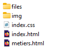
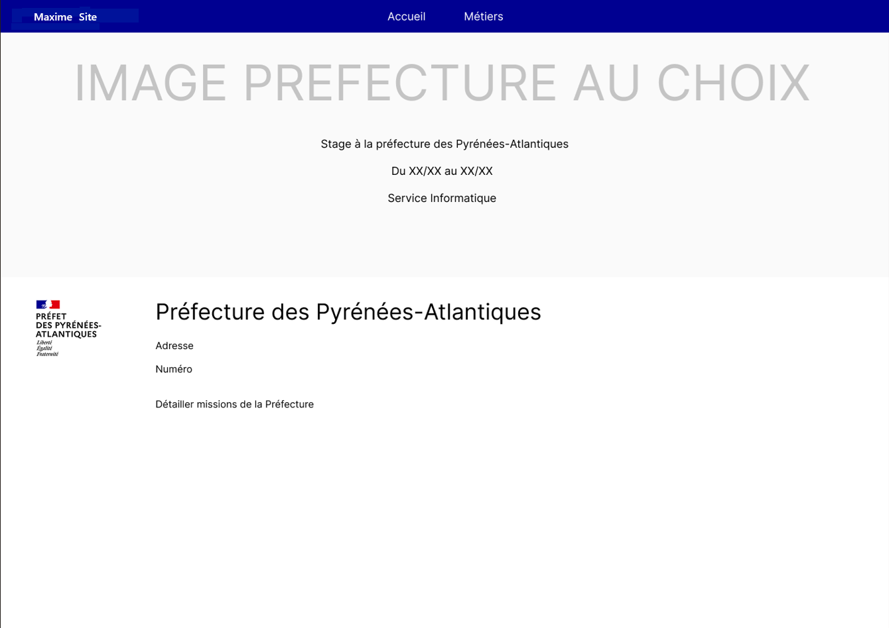
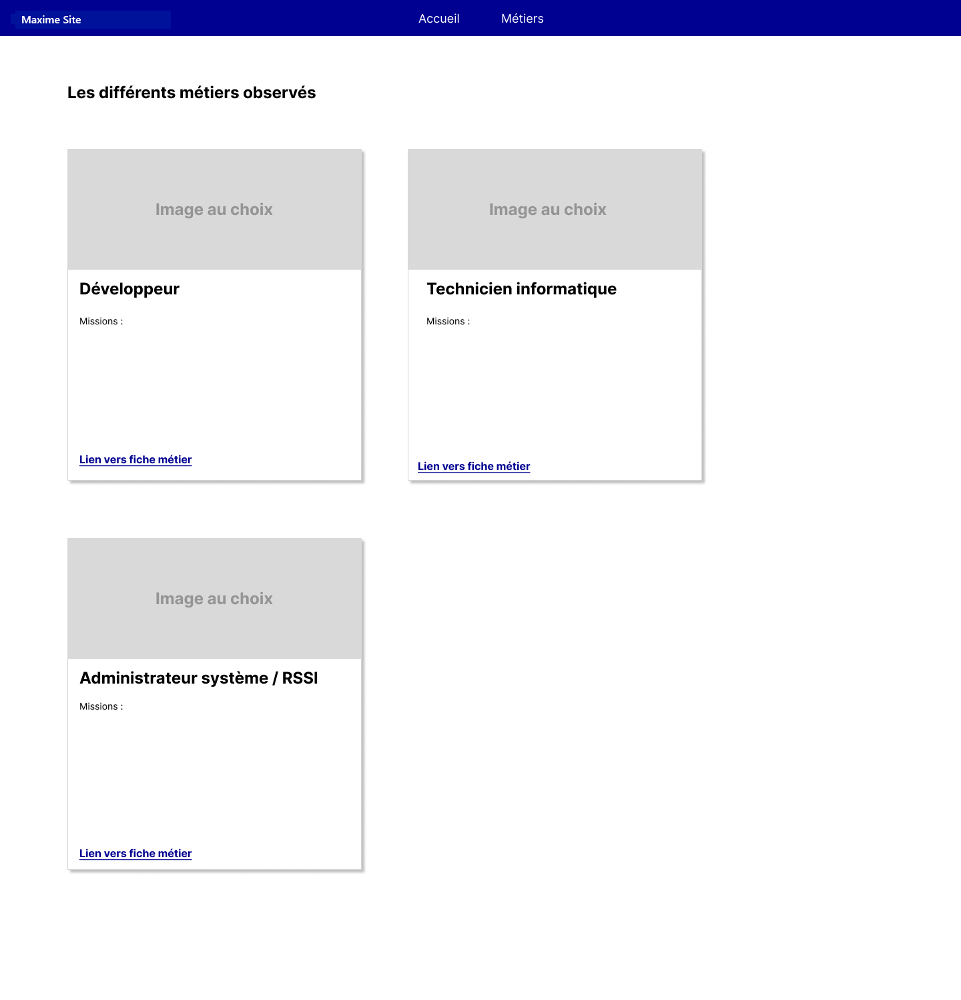
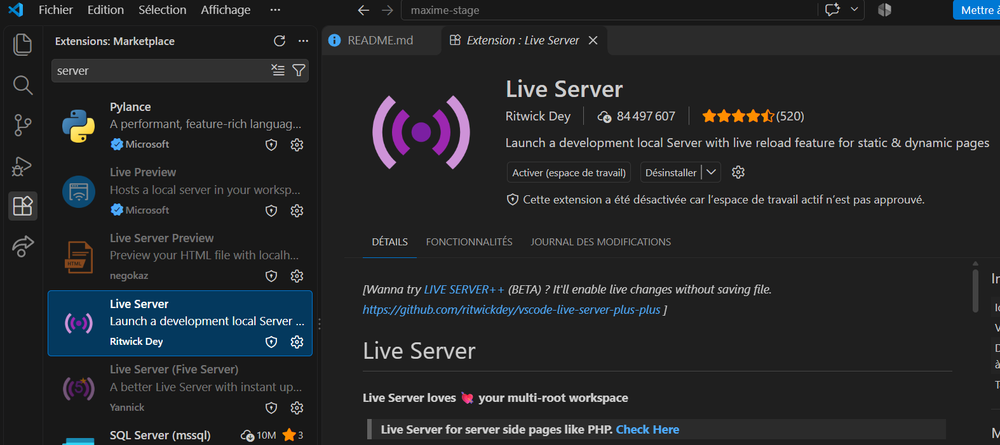
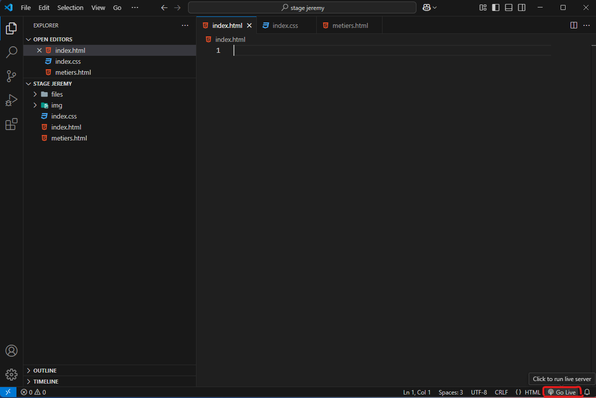

# Stage Maxime

## Maxime's challenge

## Objectifs :

- Création d'un site internet de présentation de la Préfecture des Pyrénées-Atlantiques
- Présenter brièvement les différents métiers observés
- Initiation à HTML et CSS

## Cours associés

Ces cours permettront d'acquérir les bases du HTML/CSS : 
- https://openclassrooms.com/fr/courses/1946386-comprendre-le-web
- https://openclassrooms.com/fr/courses/1603881-creez-votre-site-web-avec-html5-et-css3

## Structure du site

Le site doit être construit de la façon suivante : 

- Création d'un dossier pour le projet global contenant la structure suivante : 

- Le dossier files devra contenir les fiches des métiers observés.
- Le dossier img devra contenir les images du site.
- index.html sera la page d'accueil du site qui contiendra la présentation de la Préfecture
- index.css devra contenir les règles de style (Couleurs, positionnement des éléments de la page etc...)
- metiers.html sera la page présentant les métiers observés durant le stage

### Interface du site 

Les éléments devront être présentés comme ceci:

Page index.html :

Page metiers.html :

- Le lien vers la fiche métier doit permettre d'ouvrir la fiche de poste associée. Les fiches de poste devront être placées dans le dossier "files" du projet.

## Éditeur de code 

- Installer Visual studio Code : https://code.visualstudio.com/

Après avoir créer les dossiers et fichiers, il suffira d'ouvrir le dossier du projet global dans Visual Studio code.

### Exécution du code dans Visual Studio Code

- Installer l'extension Liver server depuis Visual studio Code : 

Ouvrir le dossier puis lancer le serveur de développement :

Chaque modification de code dans les fichiers permettra de visualiser les modifications sur la page modifiée depuis le navigateur.

